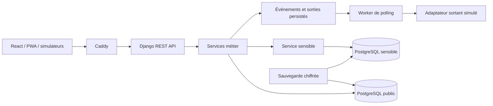

# Écoute — plateforme multicanal de feedback communautaire

Écoute est un prototype full-stack de mécanisme de feedback et de réponse communautaire (CFRM) destiné aux ONG. Il relie collecte, traitement, réponse, actions correctives et restitution. Le code et les guides originaux sont sous [licence MIT](LICENSE).

**État : prototype sur données fictives ; acceptation P1 ajournée après OS4.** SMS et messagerie sont simulés. Un défaut bloquant de cohérence lors d'une panne entre les connexions SQL ordinaire et sensible reste ouvert. Ce dépôt ne constitue pas une version autorisée pour des signalements réels. Voir [LIMITES.md](docs/LIMITES.md).

## Sommaire

- [Fonctionnalités](#fonctionnalités)
- [Démarrage rapide](#démarrage-rapide)
- [Comptes et rôles](#comptes-et-rôles)
- [Architecture](#architecture)
- [Développement et vérification](#développement-et-vérification)
- [Documentation](#documentation)
- [Résultats OS4](#résultats-os4)
- [Contribution et licence](#contribution-et-licence)

## Fonctionnalités

| Domaine | Fonctions présentes |
|---|---|
| Collecte | Formulaire public, anonymat, consentement, référence stable ; saisie assistée |
| Multicanal | Webhooks signés et simulateurs SMS/messagerie ; rejeux sans duplication ; suivi par référence et expéditeur |
| Traitement | Qualification humaine, attribution, notes internes, référencement, réponse préparée et contrôle du superviseur |
| Suivi | Échéances ouvrées, notifications internes, tentatives de contact, clôture motivée, réouverture, fusion réversible |
| Apprentissage | Actions liées aux dossiers, responsable, échéance, preuve de réalisation, restitution |
| Pilotage | I01–I10, filtres, CSV/XLSX sans récit ni coordonnées ; protection des formules |
| Terrain | Cache statique, file IndexedDB ordinaire, UUID stables, confirmation individuelle, déconnexion protégée |
| Sensible | Circuit R4, chiffrement, lectures auditées ; isolation nominale, reprise après panne non validée |
| Exploitation | Docker Compose, PostgreSQL 16, worker, sauvegardes chiffrées, tests et workflow CI |

Les réponses WEB/AGENT exigent une transmission manuelle effectivement réalisée et documentée. Aucun appel, courriel ou SMS réel n'est envoyé. Les modèles sont stockés mais leur insertion n'est pas disponible ; escalade explicite et notifications SMTP restent à implémenter.

## Démarrage rapide

Prérequis : Git, Docker démarré avec Compose v2 et Python 3.12+. Ces commandes créent une démonstration locale neuve.

```sh
git clone https://github.com/yaroing/ecoute-cfrm.git
cd ecoute-cfrm
python scripts/init_env.py
docker compose --env-file .env -f deploy/compose.yml up -d --build
docker compose --env-file .env -f deploy/compose.yml exec -T api python manage.py seed_demo
docker compose --env-file .env -f deploy/compose.yml cp api:/app/demo/credentials.json .demo-docker-credentials.json
```

Sur Windows, utiliser `py -3 scripts/init_env.py` si nécessaire. Le générateur refuse de remplacer `.env` ; conserver ses clés pour relire une base existante.

Ouvrir **http://localhost:8080**. Formulaire public : `/#public` ; connexion : `/#login`. Commencer avec `superviseur`. Mots de passe et secrets TOTP fictifs sont générés dans `.demo-docker-credentials.json`, à conserver hors Git.

`seed_demo` crée 60 dossiers fictifs (52 ordinaires, 8 sensibles). Le projet Compose par défaut est `ecoute-os3`. Si une instance existe déjà, suivre [la coexistence des instances](docs/INSTALLATION.md#coexistence-de-plusieurs-instances) pour isoler volumes et port.

```sh
# Arrêt sans suppression des volumes
docker compose --env-file .env -f deploy/compose.yml stop
# Redémarrage
docker compose --env-file .env -f deploy/compose.yml up -d
```

## Comptes et rôles

| Compte fictif | Rôle | Accès implémenté |
|---|---|---|
| Public sans compte | R0 | Dépôt uniquement, aucune lecture publique |
| agent | R1 | Collecte terrain ; ses dossiers des sept derniers jours |
| gestionnaire | R2 | Dossiers attribués, notes et préparation de réponse |
| superviseur | R3 | Ordinaires, qualification, attribution, validation et actions |
| referent | R4 + TOTP | Sensible ; droits ordinaires/audit à compléter selon S1 |
| direction | R5 | Indicateurs et actions ; aucune fiche individuelle |
| admin | R6 + TOTP | Comptes/configuration ; aucun accès sensible par ce rôle |

R4/R6 exigent un code à six chiffres d'une application TOTP ; le secret fictif est fourni au provisionnement. Le modèle affecte un seul rôle par compte : cumul R2/R3 indisponible.

## Architecture



Les schémas sont dans **la même instance PostgreSQL**, avec deux connexions et comptes applicatifs. Ils ne forment pas une transaction atomique commune. Voir [l'architecture détaillée](docs/ARCHITECTURE.md).

```text
backend/          API, services, modèles, migrations, tests
frontend/         React, PWA, tests Vitest et verrou npm
deploy/           Docker, Caddy, rôles SQL et sauvegarde
scripts/          environnement et campagnes OS4
docs/             guides, API, limites et recette
.github/workflows/ tests, qualité, audits et build
```

## Développement et vérification

Windows : `./start.ps1` installe, migre les bases SQLite, charge les exemples, construit et démarre la prévisualisation sur `http://127.0.0.1:5173`. SQLite ne fournit pas les permissions PostgreSQL. Voir [INSTALLATION.md](docs/INSTALLATION.md#développement-natif).

Après installation des dépendances de développement, depuis la racine :

```powershell
.venv/Scripts/python.exe -m pytest --cov=core --cov-fail-under=70
.venv/Scripts/python.exe -m ruff check backend deploy scripts
$env:PYTHONPATH='backend'
.venv/Scripts/lint-imports.exe
```

Linux/macOS : utiliser `.venv/bin/python`, `.venv/bin/lint-imports` et `PYTHONPATH=backend`. Puis, dans `frontend/` :

```sh
npm ci
npm run lint
npm test
npm run build
```

Le [workflow CI](.github/workflows/ci.yml) vérifie tests, couverture minimale 70 %, imports, audits et images. Sa présence ne prouve pas une exécution distante réussie : vérifier GitHub Actions sur le commit publié.

## Documentation

| Guide | Public et contenu |
|---|---|
| [Installation](docs/INSTALLATION.md) | Technicien : configuration, Docker, démarrage, développement et diagnostic |
| [Architecture](docs/ARCHITECTURE.md) | Développeur : composants, données, sécurité, transactions et décisions |
| [Manuel ONG](docs/GUIDE.md) | Utilisateur : parcours par rôle, traitement, terrain, sensible et incidents |
| [Exploitation](docs/EXPLOITATION.md) | Exploitant : clés, sauvegarde/restauration, permissions, supervision et mises à jour |
| [API](docs/API.md), [OpenAPI](docs/openapi.yaml) | Intégrateur : endpoints, authentification, signatures et idempotence |
| [Recette](docs/RECETTE.md), [limites](docs/LIMITES.md) | Projet : résultats OS4, défauts ouverts et conditions de réception |
| [Contribuer](CONTRIBUTING.md), [sécurité](SECURITY.md) | Contributeur : propositions, vérification et signalement confidentiel |
| [Publication](docs/PUBLICATION.md) | Mainteneur : contenu public, premier push et contrôles du dépôt |

## Résultats OS4

Campagne du 4 octobre 2026 : données fictives et six profils logiciels. Lot final : 98 sous-cas, 75 réussis, 13 échoués, 10 bloqués. Les 38 compléments et les autres lots sont comptabilisés séparément.

- Réception : 20/20 web et 20/20 SMS simulés ; aucun dossier supplémentaire après rejeux techniques.
- Reprise : 100 dossiers uniques après confirmations et rejeux ; téléphones non validés.
- Charge : trois montées de 120 s et plateaux de 900 s, 20 clients, 5 000 dossiers ; aucune erreur HTTP ; p95 listes/fiches inférieur à 100 ms pendant les plateaux.
- Non-régression : 21 tests serveur et 7 front-end réussis ; couverture `core` 93,99 % dans la configuration mesurée.
- Détection sensible : 4/4 explicites détectés, 2 implicites manqués, 2 faux positifs ; rappel global 4/6.

Les simulations ne mesurent ni SUS, ni autonomie, ni gain de temps humain. CPU/RAM ne couvrent pas le premier essai complet. Ces résultats ne qualifient pas une production. Voir [RECETTE.md](docs/RECETTE.md).

## Contribution et licence

Proposer une issue fictive reproductible ou une PR selon [CONTRIBUTING.md](CONTRIBUTING.md). Pour une vulnérabilité, suivre [SECURITY.md](SECURITY.md). Ne joindre ni coordonnées, ni récits réels, ni secrets. Aucun service d'assistance opérationnelle ou de traitement de signalements n'est fourni par le dépôt.

Licence [MIT](LICENSE) pour le code et les guides originaux ; les dépendances conservent leurs licences. Les documents métier fournis, rapports privés, clés, comptes, bases et sauvegardes ne sont pas publiés. Le projet n'est pas un produit officiel ni une approbation d'une organisation humanitaire.
