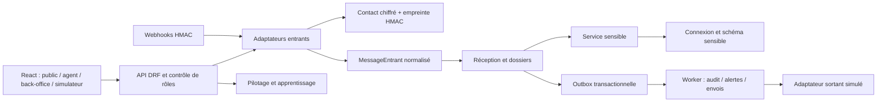

# Architecture technique Écoute

Version du 4 octobre 2026, actualisée après OS4. Le dossier OS2 sert de référence métier ; cette documentation décrit le code exécuté, ses choix et ses limites, sans considérer les consignes des documents métier comme des autorisations externes.

## Composants et points d'entrée

| Composant | Fichiers | Responsabilité |
|---|---|---|
| Interface React | frontend/src/main.jsx, api.js | Public, terrain, dossiers, sensible, pilotage, comptes/configuration |
| File terrain | frontend/src/agent-pwa/queue.js | IndexedDB, clés UUID, confirmation et garde avant logout |
| API | backend/api/views.py, serializers.py, security.py | Validation, Bearer, TOTP, filtrage par rôle, contrats HTTP |
| Adaptateurs | backend/adapters/inbound, outbound | Normalisation et signatures entrantes ; sorties simulées |
| Noyau | backend/core/*/services.py | Réception, dossiers, réponses, apprentissage, sensible, pilotage, administration, audit, événements |
| Persistance | core/models.py, core/sensible/models.py, config/router.py | Modèles ordinaires, contenu sensible, routage des connexions |
| Worker | adapters/worker.py, core/management/commands/worker.py | Polling, événements, envois, échéances, purges |
| Déploiement | deploy/compose.yml, Dockerfile.*, Caddyfile | Images, dépendances au démarrage, proxy et sauvegarde |

Monolithe modulaire : les services ordinaires partagent core et des accès ORM. Les contrats d'import évitent certaines dépendances, sans garantir la propriété exclusive de chaque table par module. Django-q2 est installé mais le worker opérationnel est celui de polling, pas un cluster django-q2.

## Flux principal

Le cœur ne dépend pas des adaptateurs HTTP ni sortants. Le worker reçoit le port `sender` par injection depuis l’adaptateur. Deux contrats d’imports sont contrôlés : le noyau ignore `api` et `adapters`, et seul le service sensible importe son modèle dédié. Le noyau contient réception, dossiers, attribution, réponses, apprentissage, sensible, pilotage, administration, audit et événements.

## Données et permissions

PostgreSQL 16 héberge les tables ordinaires dans `public`, et `SensitiveContent` dans `sensible`. Le routeur Django utilise deux connexions, deux identifiants d’exécution et deux comptes de migration distincts. `feedback_app` ne dispose pas d’USAGE sur `sensible`. `feedback_report` ne lit que `feedback_summary`. Le compte applicatif peut insérer/lire l’audit, jamais le modifier ou le supprimer ; un trigger refuse aussi ces opérations. Les propriétaires de schémas sont réservés à l’initialisation.

Les contacts et TOTP sont chiffrés par AES-256-GCM avec nonce aléatoire et contexte authentifié. L’adresse de contact ne traverse pas le contrat normalisé ; celui-ci transporte son identifiant interne. L’empreinte de rattachement utilise une clé HMAC différente de la clé de chiffrement. Les contenus sensibles, notes déplacées, réponses déplacées et transferts sont chiffrés dans la connexion dédiée. Les clés proviennent de `.env` ou du fichier local de secrets ignoré par Git ; aucune clé par défaut n’est embarquée dans l’image.

Les dossiers ordinaires sont filtrés avant lecture, puis les droits de mutation sont vérifiés. Les listes R2 ne comprennent que les dossiers attribués. Le rôle administrateur n’ouvre pas l’espace sensible. Les sessions ont un jeton court et un renouvellement rotatif, stockés dans la session du navigateur. Les mots de passe sont hachés par Argon2. TOTP est obligatoire pour R4/R6, avec prévention du rejeu dans la fenêtre courante.

Les événements ne contiennent que l’action, l’objet et l’acteur. Le journal est chaîné par SHA-256, et les notifications ne portent aucun récit ni contact. Les exports excluent les dossiers sensibles et tous les champs de texte libre. Les accès refusés aux fiches sont journalisés.

## Transactions et reprise

La réception, les transitions et leurs événements ordinaires sont transactionnels. L’allocation des références verrouille un compteur annuel ; l’idempotence est vérifiée sous ce verrou, y compris pour les messages anonymes. Les références ne sont jamais recyclées par le code. Un expéditeur ne peut compléter une référence qu’avec la même empreinte ; sinon un dossier distinct est créé.

L’envoi possède des états distincts et trois réessais après l’essai initial, à 1, 5 et 30 minutes. Le worker annule les sorties après STOP ou absence de consentement. Le statut « transmis » n’est acquis qu’après succès du port sortant, ou après attestation manuelle explicite pour WEB/AGENT. Aucun fournisseur réel n’est configuré.

La base sensible étant utilisée via une connexion indépendante, **une transaction SQL unique ne couvre pas les deux connexions**. Le contenu chiffré est écrit avant la suppression des copies ordinaires et avant le commit du changement de circuit. Un échec de la transaction ordinaire peut laisser un enregistrement chiffré orphelin ; il n’est pas affiché puisqu’aucun dossier visible ne le référence. Cette limite et une éventuelle stratégie de réconciliation doivent être traitées avant un pilote réel. Il n’y a pas de garantie distribuée « exactement une fois » sur un futur fournisseur externe ; la déduplication du fournisseur devra compléter l’outbox.

OS4 a confirmé ces anomalies par injection de panne : une bascule manuelle interrompue peut aussi conserver le texte ordinaire alors qu'une copie sensible chiffrée existe. Il n'y a pas de réconciliation durable livrée. Le chiffrement et le filtrage nominaux ne satisfont donc pas C07 ; acceptation ajournée, voir [LIMITES.md](LIMITES.md).

## Modèle de données

Les deux connexions visent la même base PostgreSQL, avec schémas public/sensible distincts ; en natif, deux fichiers SQLite remplacent cette configuration, sans ses garanties SQL.

| Entité | Fonction et liens |
|---|---|
| User, Session | Rôle unique, état compte, TOTP ; session courte et hash du renouvellement |
| Contact | Adresse chiffrée, empreinte HMAC unique, canal, consentement et STOP |
| Dossier, Counter | UUID interne, référence annuelle unique, état, propriétaire, agent, échéances et compteurs |
| Message | Clé technique unique, identifiant externe, récit, dossier et canal |
| Record | Historique métier avec auteur et données de transition |
| Reply, Outgoing | Préparation/validation d'une réponse ; file de transmission et réessais |
| Fusion | Source/cible, messages déplacés, état préalable, annulation |
| Action, Restitution | Relation plusieurs dossiers/actions ; réalisation avec preuve, restitution liée |
| Outbox, Audit, Notification | Événement minimal, chaîne de traces, notification utilisateur |
| Setting | Configuration JSON par clé |
| SensitiveContent | Contenu chiffré indexé par l'identifiant de dossier, connexion dédiée |

La séparation SQL n'est pas une séparation de serveur, de processus ou d'exploitant : PostgreSQL et le compte d'exploitation privilégié voient l'ensemble. Les propriétaires de migration et le compte de sauvegarde disposent de privilèges distincts des runtime ; ne pas les utiliser pour les requêtes quotidiennes.

## Parcours d'un message

1. L'API publique valide la charge, ou l'adaptateur vérifie HMAC et horodatage du webhook.
2. Le contact est chiffré et son empreinte calculée ; le noyau reçoit son identifiant, pas son adresse.
3. Réception sous verrou du compteur : vérifier la clé, allouer référence, enregistrer message/dossier et événements.
4. La détection lexicale cloisonne un récit reconnu ; elle n'est pas une classification sémantique exhaustive.
5. Le worker traite sorties et événements. Une livraison simulée ou une attestation manuelle reste distincte d'une compréhension ou résolution.

Une clé rejouée est différente d'un doublon métier : deux plaintes similaires avec clés distinctes peuvent produire deux dossiers, fusionnables après revue. Le rattachement par référence requiert la même empreinte expéditeur. Les délais métier sont en jours ouvrés selon le code ; toute définition organisationnelle demande validation.

## Stockage navigateur et sessions

Le service worker cache les fichiers statiques, jamais les réponses API. La file IndexedDB `ecoute-queue` contient les saisies ordinaires non confirmées avec leur auteur/clé. Seules les entrées confirmées sont retirées. La déconnexion vérifie toute la file, appelle la révocation puis efface la session lorsqu'elle est vide. Les champs explicitement sensibles sont effacés et la saisie empêchée ; un récit implicite peut échapper aux mots-clés. L'isolation d'affichage par agent n'est pas un chiffrement local ni une validation de téléphone partagé.

## Formules de pilotage implémentées

Calcul ORM dans `core/pilotage/services.py`. Filtres projet et bornes inclusives de date de création ; ordinaires fusionnés exclus. Une division par zéro retourne null.

| ID | Calcul présent |
|---|---|
| I01 | Ordinaires avec accusé dans les 24 h / ordinaires |
| I02 | Médiane des jours ouvrés création à réponse, sur dossiers avec réponse |
| I03 | Réponses sur dossiers avec contact / dossiers avec contact |
| I04 | Dossiers ouverts en retard / ouverts |
| I05 | Répartition des motifs de clôture |
| I06 | Plaintes/suggestions closes avec action / plaintes/suggestions closes |
| I07 | Actions réalisées avec restitution / actions réalisées |
| I08 | Sensibles pris en charge dans les 24 h / sensibles |
| I09 | Dossiers rouverts / dossiers actuellement clos ou déjà rouverts |
| I10 | Répartitions canal/type/thème/zone/état |

I03 utilise présence de contact, pas une population métier définitivement arbitrée. I06/I09 et les petits effectifs restent à valider. La vue SQL `feedback_summary` n'est pas la source exclusive du tableau de bord. Le compteur sensible agrégé ne donne pas accès au récit.

## Versions et vérification

Déploiement reproductible par sources, dépendances Python figées, verrou npm, images et migrations. CI locale et distante doivent être distinguées. Les données OS4, six profils logiciels, tests unitaires SQLite et essais PostgreSQL sont des périmètres différents ; consulter [RECETTE.md](RECETTE.md). Les sources V2 corrigent AR neutre, déconnexion et contrastes ; les processus anciens ne les chargent pas automatiquement.

## Écarts assumés avec OS2

| Point OS2 | Implémentation du prototype |
|---|---|
| Isolation des modules et propriété stricte des tables | Services séparés et règles d’imports ; modèles ordinaires regroupés dans `core/models.py`. Des accès ORM intermodules restent présents. |
| Worker django-q2 | Dépendance et configuration disponibles ; worker de polling dédié toutes les 10 secondes, plus traitement immédiat des sorties lors des interactions de démonstration. |
| Pilotage exclusivement par vues SQL | Vue agrégée et rôle lecture créés ; indicateurs I01–I10 calculés par projections ORM sans jointure vers Contact. Le rôle lecture agrégée n’alimente pas encore tout le tableau de bord. |
| Circuit suspecté puis confirmation humaine | Cloisonnement conservateur immédiat ; le référent confirme la prise en charge. Le retour vers le circuit ordinaire n’est pas exposé. |
| Notification courriel | Notifications internes persistées ; aucun serveur SMTP ni transfert réel configuré. |
| SMS multipart physique | Compteur GSM-7/Unicode et réception de texte normalisé ; assemblage des segments physiques d’un fournisseur à ajouter avec l’adaptateur réel. |
| Administration ergonomique et langues locales | Paramètres métier via JSON ; français livré. Le catalogue local et les traductions attendent la validation ONG. |
| Authentification hors ligne | Onglet déjà authentifié et cache statique ; une nouvelle session démarre en ligne. Les sessions expirées doivent être renouvelées en ligne avant synchronisation. |
| Journaux et conservation | Audit immuable, purge des contacts et contenus sensibles clos ; politique détaillée de conservation des sauvegardes à fixer. |
| Production HTTPS et sauvegarde hors serveur | Compose de recette lié à loopback en HTTP ; Caddy fourni pour TLS sur un domaine. Sauvegarde chiffrée locale testée, destination hors serveur non configurée. |

Ces écarts empêchent de revendiquer une conformité totale à toutes les exigences non fonctionnelles ou une autorisation de mise en production. Les quatre parcours prioritaires peuvent néanmoins être exécutés avec des données fictives.
